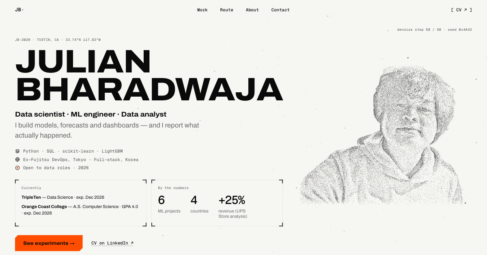

# Julian Bharadwaja — Latent Space



The portfolio of Julian Bharadwaja, data scientist and ML engineer in Tustin, CA.
Live at <https://jbharadwaja.github.io/my-portfolio/>.

One particle field fills the screen and the camera flies through it. The field re-forms for each section:
a portrait in the hero, a neural network, a training run, a rail of six ML projects and two field analyses, a
route across four countries on a night ground, and a signed-off name. Every project states its result against
a target or baseline, with an honest verdict.

## How it is built

The site is plain HTML, CSS and ES modules. There is **no build step** and nothing to install: the files in this
repository are the files that GitHub Pages serves.

- **One field, many shapes.** A single `THREE.Points` object carries 10,000 to 48,000 particles, depending on the
  device. Each shape (portrait, network, loss landscape, project clusters, world map, name) is a point set computed
  once on the CPU. The scroll position picks a pair of shapes and how far to mix between them; the vertex shader
  does the blend, so changing section only swaps which two sets are bound.
- **Scroll.** Lenis smooths the scroll, and GSAP + ScrollTrigger pin the stages and scrub them: the training run
  rolls a ball down the loss landscape, the project rail slides sideways, the route's night falls and lifts. All
  scrolling goes through one module, `js/ui/scroll.js`, so a nav jump, the keyboard and the rail agree about where
  the page is. Touch scrolling stays native.
- **Libraries.** three.js, GSAP + ScrollTrigger and Lenis load from jsDelivr through an import map at exact pinned
  versions (three 0.186.1, GSAP 3.15.0, Lenis 1.3.26). Fonts (Archivo, Geist Mono) load from Google Fonts. Every CDN
  module is reached through `await import()` inside `try/catch`, so a failing CDN cannot take the page down.
- **Copy lives in the HTML.** The page's copy is in `index.html`. `js/content.js` holds only what scripts print that
  the static page does not carry: the ~ console's text, the cursor's rail label and the CV link states. The console
  reads its projects, skills and contacts from the page's own DOM, so it cannot disagree with it.
- **It degrades instead of breaking.**
  - Without JavaScript the page reads top to bottom as a one-page resume.
  - Without WebGL the hero portrait is a static halftone and the route map is drawn on a 2D canvas; the encoder
    keeps its label grid.
  - If the CDN fails or is slow, scrolling is native, a banner names what has not loaded, and the page stays readable.
  - `prefers-reduced-motion` is followed live.
  - The loading veil never hangs: it lifts by 8.6 s whatever fails.
- **Device tiers.** The particle count, the pixel-ratio cap and whether the pointer repels particles follow the
  device (data saver, memory, width, pointer type), and adaptive quality steps down when frames run long.

## Layout

```
index.html        all page copy (the single source), head meta, JSON-LD, import map, module preloads
404.html          self-contained error page (inline CSS, no JS; the one file that uses absolute paths)
css/main.css      tokens, type, layout, components; css/sections/*.css one stylesheet per section
js/main.js        boot: tier, dynamic imports, scroll, sections
js/boot-inline.js readable copy of the inline script at the top of index.html (the veil's 8.6 s cap and the
                  failure banner); a test keeps the two identical, and the page itself never loads this file
js/content.js     off-page strings: the ~ console's text, the cursor's rail label, the CV publish state
js/engine/        WebGL particle engine: scene, particles, shaders, morph, resolver, formations/
js/sections/      scroll wiring and DOM for the hero and each section
js/ui/            veil, scroll (the only door to scrolling), nav, split text, cursor, the ~ console, halftone reveal,
                  the Route's no-WebGL map (fallback-map.js, loaded only when it is needed)
js/data/          baked world-map dot lattice
assets/img/       portraits, icons (favicon.svg, favicon-32.png, apple-touch-icon.png), og.png (the social
                  preview, 1200 × 630)
tests/            node:test suites
.nojekyll         tells GitHub Pages to serve the files as they are
```

## Local development

From this directory:

```sh
python3 -m http.server 5173
```

Then open <http://localhost:5173/>. The page needs a network connection for the CDN libraries and fonts.
Use a plain static server: `file://` does not work, because ES modules and the import map need HTTP.

`http.server` lets the browser cache modules and stylesheets, so while editing, hard-reload (or tick "Disable
cache" in the browser's developer tools) to be sure you are looking at the file on disk.

## Tests

```sh
npm test
```

This runs `node --test "tests/**/*.test.mjs"` (Node 22 or newer). There are no dependencies to install;
`package.json` exists only for `"type": "module"` and the test script. Each file in `tests/` covers one subject:

| File | Covers |
|---|---|
| `common` | the seeded random generator, sampling, and the shared formation helpers (dust, shuffle, noise, galaxy) |
| `console` | the ~ console's commands, completion and edit distance, focus and keys (fake DOM); the cursor's maths |
| `content` | the page copy in `index.html`: sections, cards (charts, links), route stops, the About photo, CV links |
| `contrast` | text against what is behind it: the text keep-out the particles and the dust share, and the paper grounds of muted text over the canvas |
| `cv` | the CV link state: the LinkedIn fallback that ships and the publish state, written to every CV link |
| `density` | the particle density estimate: alpha and point size per tier |
| `framing` | camera framing: distance, shift and pose blending |
| `geo` | the world-map dot lattice, its projection and the latitude/longitude readout |
| `halftone` | the halftone reveal (the About photo, and the no-WebGL hero portrait): dots, healing, the touch sweep |
| `head` | `<head>`: import map, fonts, preloads, the inline boot script, the veil markup and its critical CSS |
| `landscape` | the training run: the loss landscape, the resampled descent, HUD values, the no-JS curve and HUD line, stage layout |
| `meta` | SEO meta and JSON-LD, module preloads, the icon set and image assets, `404.html`, `og.png`, `.gitignore` and this README (this table too) |
| `morph` | formation pair changes: hand-offs (a stand-in's too), the dip on far jumps, a dip that turns round, and a cut jump's snap |
| `name` | the sign-off name formation and its layout rects |
| `nav` | the section HUD's resting state: hidden at once in the hero, fading back in after it |
| `network` | the encoder's network formation and its active layer |
| `portrait` | the hero: image weights, the portrait formation, its layout and the entrance |
| `rail` | the experiments rail: geometry, clusters, charts and count-ups |
| `resolver` | which formation pair the scroll shows, the entrance, dips and the night ramp |
| `route` | the world map and route formation, the Route timeline, the night ground, the reticle readout, the no-WebGL map |
| `scaffold` | the section list, the section stylesheets and `init` exports, and how `main.js` loads them |
| `scroll` | scroll maths (jumps, landing points, rail centring, current section, restoring a place, keeping it across a resize) and the scroll module itself (Lenis on and off, jumps while locked, the lock's scrollbar gutter) |
| `sections` | the section loader: every import at once, inits one after another in page order, failures logged |
| `split` | metric parsing and formatting for the count-ups, split words' plain-text advances, split text copied once |
| `tier` | device tier choice, the DPR budget, resize filtering and adaptive quality |
| `veil` | the loading veil's progress, the boot script's never-hang lift and banner, and the wait for the font sheets |

## Debug flags

Query flags, harmless in production:

| Flag | Effect |
|---|---|
| `?debug` | Overlay with the tier, particle count, DPR, fps and the current morph pair (from, to, mix). |
| `?nowebgl` | Behave as if WebGL were unavailable: the no-WebGL fallbacks (static halftone portrait, label grid, 2D map). |
| `?simulate=cdnfail` | A CDN import fails: the banner names the URL, the veil still lifts, scrolling is native. |
| `?simulate=hang` | Boot never signals ready: the 8 s cap lifts the veil. |

## Generated assets

A few assets are generated once and committed, not built at deploy time. The small scripts that made them are not
part of this repository.

- `portrait-cutout.webp` is the hero portrait. `cutout.swift`, a macOS tool built on Apple Vision's foreground mask,
  cuts the subject out of the photograph offline; the cut-out PNG is encoded with
  `cwebp -q 80 -alpha_q 100 -m 6 -sharp_yuv`. `portrait-full.webp` is the uncut photograph at the About crop.
- `js/data/worldmap-dots.js` is the world-map dot lattice. `bake-worldmap.mjs`, a zero-dependency Node script, turns
  the `world-atlas` land TopoJSON (`land-110m`) into a 260-column grid of land dots, packed as runs.
- `favicon-32.png` and `apple-touch-icon.png` are rendered from `favicon.svg` in headless Chrome. The touch icon is
  opaque and fills its square, because iOS paints transparency black and rounds the corners itself.
- `og.png` is a 1200 × 630 screenshot of the hero after the entrance (portrait formed, veil gone). Regenerate it
  whenever the hero changes.

## Deploy

GitHub Pages serves the `main` branch of `jbharadwaja/my-portfolio` as it is: no workflow, no build. Work happens
on the `latent-space` branch, and a release fast-forwards `main` to it, so every commit is kept and the earlier
version of the site stays in the history:

```sh
git switch main
git merge --ff-only latent-space
git push origin main
```

Pages is already enabled for the repository. Afterwards, check that <https://jbharadwaja.github.io/my-portfolio/>
serves the new site.

Notes:

- Asset paths are relative so the `/my-portfolio/` sub-path works. `404.html` is the one file with absolute
  paths (`/my-portfolio/...`), because GitHub Pages serves it at any missing URL, however deep.
- `.nojekyll` keeps Pages from running Jekyll over the files.
- The CV links currently go to LinkedIn, and `assets/cv/` does not exist. To publish a PDF, add it as
  `assets/cv/Julian_Bharadwaja_Resume.pdf` and set `CV_PUBLISHED` to `true` in `js/content.js`: every CV link
  then downloads the file.

## Credits

Design, code and copy: Julian Bharadwaja.

- [three.js](https://threejs.org/) (MIT) draws the particle field.
- [GSAP](https://gsap.com/) and ScrollTrigger by GreenSock drive the pinned, scrubbed stages.
- [Lenis](https://lenis.darkroom.engineering/) (MIT, Darkroom Engineering) smooths the scroll.
- Fonts: [Archivo](https://fonts.google.com/specimen/Archivo) and
  [Geist Mono](https://fonts.google.com/specimen/Geist+Mono), both under the SIL Open Font License, served by
  Google Fonts.
- Map data: [world-atlas](https://github.com/topojson/world-atlas) (ISC), built from Natural Earth.

The libraries and fonts keep their own licences. This repository carries no licence file of its own.
